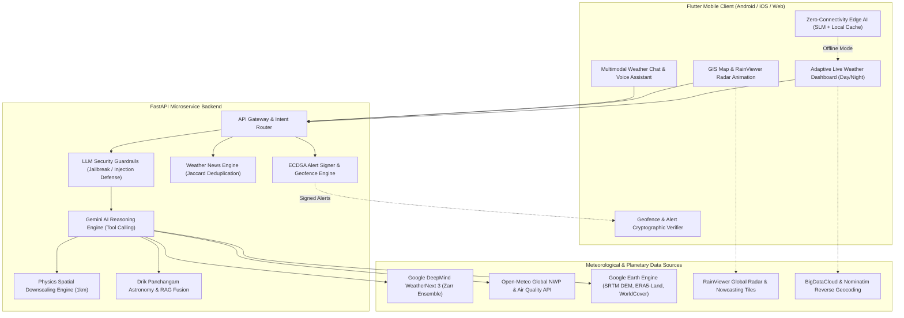

<div align="center">

# 🌤️ Weather GPT
### Hyperlocal, Multimodal Weather Intelligence & GIS Platform
**Powered by DeepMind WeatherNext 3, Physics-Informed 1km Spatial Downscaling, Indic Edge AI & Drik Panchangam Astronomy**

[](https://flutter.dev)
[](https://fastapi.tiangolo.com)
[](https://python.org)
[](https://deepmind.google)
[](test/)
[](LICENSE)

</div>

---

## 📖 Overview

**Weather GPT** transforms weather prediction from generic, text-heavy forecast lookups into a **scientific, hyperlocal, multimodal decision platform**. 

Standard weather apps and LLMs suffer from coarse NWP grid blindness (11 km – 25 km grid cells), flattening crucial microclimatic variations such as orographic cooling in hilly terrain, Urban Heat Islands (UHI) in concrete districts, and coastal sea breezes. Furthermore, conventional weather apps lack cultural agricultural planning, offline zero-connectivity resilience, and vernacular language access.

**Weather GPT** bridges these gaps by combining:
1. **Google DeepMind WeatherNext 3** 64-member physical ensemble modeling with **Open-Meteo** and GEE satellite telemetry.
2. **Physics-informed 1km spatial downscaling** (lapse-rate adjustments, WorldCover land-cover thermodynamics, solar aspect biases).
3. **Day & Night Adaptive Live Weather Dashboard** with 24-hour temperature spline curves, solar zenith flares, nocturnal starfields, and compass wind dials.
4. **Interactive GIS Map** featuring RainViewer animated radar with timeline scrubbers, 25km AQI spatial dispersion heatmaps, and high-resolution weather report card sharing.
5. **Zero-Connectivity Offline Edge AI** running quantized Small Language Models (SLMs) on-device with localized SQLite/SharedPreferences caching and instant disaster safety protocols.
6. **Hybrid Drik Panchangam RAG** calculating traditional Vedic lunisolar calendar limbs (*Tithi, Nakshatra, Yoga, Karana, Rahu Kaal, Abhijit Muhurtham*) fused with multi-day meteorological physics.
7. **Multilingual Indic Vernacular Voice Assistant** supporting 7+ languages (Hindi, Telugu, Tamil, Kannada, Malayalam, Bengali, Marathi) with custom phonetic transliteration.
8. **Cryptographic Alert Verification** utilizing ECDSA secp256k1 & HMAC-SHA256 signatures for spoof-proof emergency disaster warnings and geofencing.

---

## 🏛️ System Architecture



---

## ✨ Key Features & Capabilities

### 1. ☀️ Adaptive Live Weather Dashboard (Day & Night)
- **Automatic Solar Coordinates Switching**: Adapts fluidly between Day and Night themes according to local solar elevation, with manual override in the options menu.
- **Daylight Azure Mode**: Radiant azure blue gradient (`#4FA0FA` → `#1E6FDC`) with procedural, soft translucent cumulus clouds.
- **Cosmic Midnight Mode**: Deep navy gradient (`#071739` → `#1B4D96`) populated with twinkling star clusters.
- **Hero Telemetry**: Large light-weight temperature with superscript `°c`, high/low spread, and clean US AQI capsule with leaf/mask indicators.
- **24-Hour Continuous Temperature Spline**: Smooth lime-yellow Bezier curve (`#D4E157`) plotting temperature trajectories, vertical dotted drop-line at `Now`, sunrise/sunset markers, and wind speed.
- **Meteorological Asymmetric Grid**:
  - **Wind Compass Card**: Circular 360° compass dial with a dynamic pointer needle tracking wind azimuth.
  - **Solar / Lunar Parabolic Arc**: Shows the path of the sun (with radiant midday flare at zenith apex) or moon past sunset.
  - **Vital Metrics Card**: Live telemetry for Humidity, Real Feel, UV Index, Barometric Pressure, and Precipitation Probability.
- **Dynamic Location Auto-Detection**: Instant high-accuracy GPS positioning with client-side IP geolocation and reverse geocoding fallback.

### 2. 🗺️ Interactive GIS Map & Animated Rainfall Radar
- **Rainfall Radar Animation**: Integrates RainViewer past & nowcast radar frames on a 500ms cycle, featuring a rotating radar sweep beam, advection-displaced precipitation storm cells, and interactive play/pause and time scrubber controls.
- **AQI Heatmap Layer**: Evaluates radial dispersion stations across urban transit, industrial, forest buffer, and foothill zones with color-coded US AQI scale (Good to Hazardous).
- **Share Weather Report Card**: Renders high-resolution branded weather cards with timestamp, coordinates, hero temp, metrics, and radar status, exportable via `share_plus` as an image or bulletin text.

### 3. 🔬 Physics-Informed 1km Spatial Downscaling
- **Orographic Lapse Rate**: Adjusts coarse temperature models by `-6.5°C per 1,000m` elevation difference and dew point by `-2.0°C per 1,000m`.
- **Urban Heat Island (UHI)**: Models concrete thermal inertia and night-time heat retention using European Space Agency (ESA) WorldCover land-use data.
- **Canopy & Coastal Moderation**: Simulates forest evapotranspirative cooling and coastal sea-breeze thermal moderation.
- **Solar Slope/Aspect Bias**: Computes incident solar radiation depending on terrain slope and cardinal azimuth aspect.
- **Magnus-Tetens Formula**: Recomputes relative humidity from downscaled temperature and dew point to ensure physical thermodynamic consistency.

### 4. 📴 Zero-Connectivity Edge AI & Offline SLM
- **On-Device Small Language Model (SLM)**: Quantized local model runtime capable of answering weather queries with zero internet connection.
- **Local Telemetry Caching**: Transparent on-device cache (`OfflineWeatherCache`) storing the latest multi-hour telemetry, 1km downscaling, and Panchangam data.
- **Emergency Helpline Protocols**: Built-in emergency helplines (National Disaster Relief, Ambulance, Police, Fire, Women's Helpline) automatically referenced during severe weather queries without network access.
- **Conditional UI Suppression**: Intelligently suppresses weather cards for non-weather queries to keep conversations focused.

### 5. 🕉️ Hybrid Drik Panchangam RAG
- **Five Astronomical Limbs (*Pancha-Anga*)**: Computes exact celestial positions using `PyEphem` and *Lahiri Ayanamsa* for *Vara*, *Tithi*, *Nakshatra*, *Yoga*, and *Karana*.
- **Auspicious & Inauspicious Windows**: Accurately calculates *Abhijit Muhurtham*, *Brahma Muhurtham*, *Rahu Kaal*, *Yamaganda*, and *Gulika Kaal*.
- **Agricultural & Cultural Fusion**: Fuses upcoming rain/storm probabilities with astronomical windows to recommend optimal timings for crop harvesting, sowing, travel, and religious observances.

### 6. 🗣️ Indic Vernacular Voice Assistant
- **Bidirectional Multilingual STT & TTS**: Voice-driven weather conversations in 7 Indic languages: **Hindi (हिन्दी), Telugu (తెలుగు), Tamil (தமிழ்), Kannada (ಕನ್ನಡ), Malayalam (മലയാളം), Bengali (বাংলা), and Marathi (मराठी)**.
- **Phonetic Unit Expansion**: Automatically translates metric abbreviations (e.g., `km/h`, `°C`, `mm`, `mbar`) into spoken vernacular phrasing.
- **Devanagari Disambiguation**: Distinguishes Marathi from Hindi using distinctive verbal inflection markers and vocabulary.

### 7. 🛡️ Cryptographic Security & LLM Guardrails
- **Signed Disaster Risk Zones**: All critical weather hazard alerts are cryptographically signed using **ECDSA secp256k1** and **HMAC-SHA256**, verified on-device before notification triggers.
- **Geofence Perimeters**: Real-time Haversine distance tracking against circular and polygonal hazard zones.
- **AI Safety Guardrails**: Multi-tier prompt injection defense, SQL/code execution sanitization, and instruction override filters in the FastAPI gateway.

---

## 📂 Project Structure

```
WeatherGPT/
├── backend/                             # FastAPI Backend Service
│   ├── app/
│   │   ├── main.py                      # Application Entry Point & CORS Setup
│   │   ├── config.py                    # Environment & Model Settings
│   │   ├── routers/
│   │   │   ├── weather.py               # Weather, Downscale, AQI Grid & Panchangam Endpoints
│   │   │   ├── chat.py                  # AI Chat Completion & Guardrail Interception
│   │   │   ├── news.py                  # Weather News & Categories Endpoints
│   │   │   ├── alerts.py                # ECDSA Signed Alerts & Verification
│   │   │   └── voice.py                 # Indic Vernacular Languages & TTS
│   │   └── services/
│   │       ├── ai_service.py            # Gemini 3.5 Function Calling & Multi-Tool Agent
│   │       ├── weather_service.py       # WeatherNext 3 / Open-Meteo & AQI Dispersion
│   │       ├── spatial_downscaling.py   # 1km Orographic & Land-Cover Physics Engine
│   │       ├── earth_engine_service.py  # Google Earth Engine Terrain & Satellite Telemetry
│   │       ├── panchangam_service.py    # Drik Panchangam Astronomy & RAG Engine
│   │       ├── news_service.py          # Weather News Engine & Jaccard Deduplication
│   │       ├── alert_service.py         # ECDSA Cryptographic Signatures & Risk Zones
│   │       ├── indic_voice_service.py   # Indic Transliteration, Script & TTS Sanitizer
│   │       └── guardrails_service.py    # LLM Security, Injection & Jailbreak Defense
│   ├── tests/                           # 53 Automated Unit & Integration Tests
│   └── requirements.txt                 # Backend Python Dependencies
│
├── lib/                                 # Flutter Mobile Client Application
│   ├── main.dart                        # Client Entry Point & Navigation
│   ├── core/
│   │   ├── api/weather_api_client.dart  # Multi-Tier Backend Client & Auto-Discovery
│   │   ├── ai/offline_edge_ai_service.dart # On-Device Quantized SLM Inference Engine
│   │   ├── cache/offline_weather_cache.dart # Persistent Telemetry & Coordinate Cache
│   │   ├── location/location_service.dart   # Geolocator GPS Wrapper
│   │   └── notifications/geofence_service.dart # Cryptographic Alert Verification
│   └── features/
│       ├── weather/screens/live_weather_screen.dart # Day/Night Live Weather Dashboard
│       ├── map/
│       │   ├── screens/map_screen.dart             # Full-Screen Vector GIS Map
│       │   ├── services/rainviewer_service.dart    # RainViewer Radar Frames Fetcher
│       │   └── widgets/
│       │       ├── radar_animation_controls.dart   # Play/Pause & Frame Scrubber
│       │       ├── radar_sweep_painter.dart        # Concentric Radar Sweep Painter
│       │       └── aqi_heatmap_layer.dart          # Spatial Dispersion Heatmap Layer
│       ├── chat/
│       │   ├── screens/chat_screen.dart            # Conversational Weather Screen
│       │   ├── services/weather_share_service.dart # Report Card Modal & Image Exporter
│       │   └── widgets/
│       │       ├── weather_card_bubble.dart        # Interactive Weather Card Bubble
│       │       └── weather_share_card.dart         # Branded RepaintBoundary Share Card
│       ├── news/screens/news_screen.dart           # Curated Weather News Interface
│       ├── voice/screens/voice_assistant_screen.dart # Indic Voice Assistant Screen
│       └── profile/screens/settings_screen.dart    # App Settings & Model Providers
│
└── test/                                # 51 Automated Flutter Widget & Unit Tests
```

---

## 🚀 Quickstart & Setup Guide

### Prerequisites
- **Flutter SDK**: `^3.19.0` (or later) with Dart `^3.3.0`
- **Python**: `3.10+`
- **Google Cloud Platform (Optional for live Earth Engine / WeatherNext 3)**: Service Account with Earth Engine & GCS Viewer access.

---

### 1. Backend Setup (FastAPI)

1. **Navigate to the backend directory and set up a virtual environment:**
   ```bash
   cd backend
   python -m venv venv
   
   # Windows PowerShell:
   .\venv\Scripts\Activate.ps1
   # macOS / Linux:
   source venv/bin/activate
   ```

2. **Install Python dependencies:**
   ```bash
   pip install -r requirements.txt
   ```

3. **Configure Environment Variables (`backend/.env`):**
   ```env
   GEMINI_API_KEY=your_gemini_api_key_here
   PORT=8000
   HOST=0.0.0.0
   ENVIRONMENT=development
   
   # Optional Google Cloud Telemetry
   GEE_SERVICE_ACCOUNT=weather-service@project.iam.gserviceaccount.com
   GEE_PRIVATE_KEY_PATH=./service_account.json
   ```

4. **Run the FastAPI development server:**
   ```bash
   uvicorn app.main:app --host 0.0.0.0 --port 8000 --reload
   ```
   *The interactive Swagger API documentation will be available at: `http://localhost:8000/docs`*

---

### 2. Mobile Client Setup (Flutter)

1. **From the repository root, install Flutter packages:**
   ```bash
   flutter pub get
   ```

2. **Configure Backend URL (if not using automatic localhost/emulator discovery):**
   Create or edit an `.env` file in the root directory:
   ```env
   BACKEND_URL=http://localhost:8000
   ```

3. **Run on an emulator or connected device:**
   ```bash
   # Windows Desktop
   flutter run -d windows

   # Android Device / Emulator
   flutter run -d android

   # Chrome Web Preview
   flutter run -d chrome
   ```

---

## 🧪 Testing & Verification

Weather GPT is backed by a **100% passing test suite** covering mathematical physics, cryptographic verification, UI rendering, and offline edge resilience:

```bash
# 1. Run Backend Python Test Suite (53 Tests)
python -m unittest discover -s backend/tests -v

# 2. Run Flutter Client Test Suite (51 Tests)
flutter test

# 3. Run Static Code Analysis
flutter analyze
```

### Test Coverage Highlights:
- **53 Backend Tests (`backend/tests/`)**:
  - `test_spatial_downscaling.py`: Lapse rate, hypsometric pressure, UHI warming, aspect solar bias, Magnus equation.
  - `test_weathernext_primary.py`: 64-member ensemble aggregation, fallback handling, AQI dispersion grid generation.
  - `test_panchangam_rag.py`: 5 limbs calculation, Muhurtham windows, festival detection, agricultural suitability scoring.
  - `test_alert_signing.py`: ECDSA secp256k1 signature validation, HMAC verification, tampered payload rejection.
  - `test_indic_voice.py`: 7-language detection, Marathi disambiguation, unit phonetic expansion.
  - `test_guardrails.py`: Prompt injection interception, SQL/code execution defense.
  - `test_news_service.py`: Multi-source aggregation, Jaccard semantic deduplication, category filtering.
- **51 Flutter Tests (`test/`)**:
  - `live_weather_screen_test.dart`: Azure Day & Cosmic Midnight UI rendering, temperature curve, automatic GPS resolution, theme switcher.
  - `map_screen_test.dart`: RainViewer radar controls, playback toggles, AQI heatmap layer, weather report card preview modal.
  - `offline_edge_ai_test.dart`: On-device SLM inference, emergency helplines, conditional weather cards, cache invalidation.
  - `news_screen_test.dart`: Category chip filters, clean card layouts.
  - `alert_verifier_test.dart`: On-device cryptographic signature checks and Geofence breach triggers.

---

## 📡 API Reference Summary

| Endpoint | Method | Description |
| :--- | :---: | :--- |
| `/api/weather/current` | `GET` | Current weather with 1km micro-climate downscaling & AQI. |
| `/api/weather/forecast` | `GET` | 7-day hourly and daily forecast with precipitation probabilities. |
| `/api/weather/downscale` | `GET` | Standalone 1km physics downscaling for any geographic point. |
| `/api/weather/weathernext` | `GET` | Google DeepMind WeatherNext 3 physical ensemble telemetry. |
| `/api/weather/panchangam` | `GET` | Drik Panchangam astronomical calculation fused with weather. |
| `/api/weather/aqi-grid` | `GET` | Spatial dispersion monitoring grid for GIS heatmap rendering. |
| `/api/chat/completions` | `POST` | AI weather assistant with Gemini tool-calling and guardrails. |
| `/api/chat/languages` | `GET` | Supported Indic vernacular languages and TTS metadata. |
| `/api/news` | `GET` | Deduplicated real-time weather news and scientific bulletins. |
| `/api/alerts/active` | `GET` | ECDSA-signed active disaster alerts and risk cells. |
| `/api/alerts/verify` | `POST` | Cryptographic signature validation for alert payloads. |

---

## 🤝 Contributing

Contributions are warmly welcomed! Please adhere to the following workflow:
1. Fork the Project repository.
2. Create your Feature Branch (`git checkout -b feature/InnovativeFeature`).
3. Commit your Changes (`git commit -m "feat: Add InnovativeFeature"`).
4. Verify tests (`flutter test && python -m unittest discover -s backend/tests`).
5. Push to the Branch (`git push origin feature/InnovativeFeature`).
6. Open a Pull Request.

---

## 📄 License

Distributed under the **MIT License**. See `LICENSE` for more information.

<div align="center">
  <sub>Built with ❤️ by the Weather GPT Team</sub>
</div>
